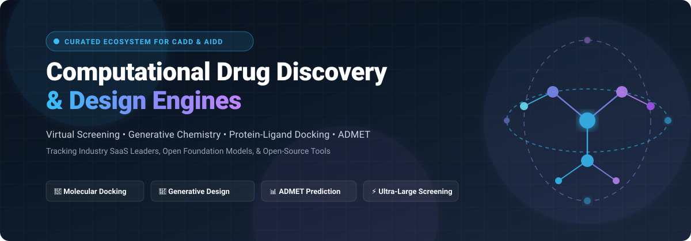

# Awesome-Computational-Drug-Discovery-Design-Engines 🧬💊

  

  
  
  
  
  
  

---

## 🚀 Top Computational Drug Discovery & Design Engines Ecosystem

> **Curated directory of cutting-edge AI in Drug Discovery (AIDD), Computer-Aided Drug Design (CADD) platforms, Foundation Models, and Open-Source Cheminformatics engines.**  
> *Covering Virtual Screening (VS), Molecular Dynamics (MD), Generative Chemistry, Biomolecular Structure Prediction, Retrosynthesis, and ADMET profiling.*

**Last updated: March 2026** 📅

This repository tracks notable enterprise **SaaS platforms** and high-impact **open-source repositories** for **Computational Drug Discovery & Design**. These engines enable researchers, biotech startups, and pharmaceutical innovators to screen billions of compounds, generate novel synthesizable molecules, predict ADMET and pharmacokinetics profiles, and model complex target-ligand interactions—radically accelerating hit identification and lead optimization.

**Leading Industry Platforms** include Schrödinger, Recursion Pharmaceuticals, Insilico Medicine, Genesis Therapeutics, Iktos, Relay Therapeutics, Atomwise, Exscientia, Owkin, and Valo Health.

**Open-Source & Foundation Model Emphasis**: Curated for computational chemists, biophysicists, ML bio-engineers, and researchers looking for transparent, self-hosted, vendor-independent architectures for molecular docking, deep learning scoring, and de novo molecular generation.

---

## 📑 Table of Contents

- [📊 Sector Overview & Market Dynamics](#-sector-overview--market-dynamics)
- [🏢 SaaS/Hosted Platforms](#-saashosted-platforms)
- [💻 Open-Source GitHub Projects](#-open-source-github-projects)
  - [⭐ Open-Source Leaderboard (Sorted by Stars)](#-open-source-leaderboard-sorted-by-stars)
  - [🧩 High-Impact Niche & Specialized Tools](#-high-impact-niche--specialized-tools)
- [🤝 How to Contribute](#-how-to-contribute)
- [💖 Support & Sponsorship](#-support--sponsorship)
- [📈 Star History](#-star-history)
- [⚠️ Disclaimer](#️-disclaimer)

---

## 📊 Sector Overview & Market Dynamics

The global computational drug discovery and AI in drug design market was valued at approximately **$2.5B–$4.0B in 2024** and is projected to expand beyond **$14B–$20B by the mid-2030s** (registering an estimated CAGR of 20%–25%+), driven by high-throughput screening informatics, generative chemistry, and structural foundation models. 

The sector is **moderately fragmented yet consolidating**: while hundreds of specialized venture-backed point-solution startups and big pharma in-house teams prevent a pure "winner-take-all" monopoly, tier-1 consolidators (such as Recursion acquiring Exscientia, and Schrödinger's entrenched enterprise footprint) are establishing high-scale computational biopharma platforms.

---

## 🏢 SaaS/Hosted Platforms

| Platform | Company Size (Valuation / Market Cap / Revenue) | Pricing | Free Tier Limits | Description |
| :--- | :--- | :--- | :--- | :--- |
| **[Relay Therapeutics](https://relaytx.com/)** 🧬 | ~$3.9B Market Cap (~$10M TTM rev) | Enterprise/partnership contracts starting at multi-million upfront collaboration licenses | Free pilot evaluation (14–30 days) upon enterprise review; no permanent free tier | Precision biotech integrating protein dynamic simulations (Motion Platform) and machine learning for allosteric drug discovery. |
| **[Valo Health](https://valohealth.com/)** 🔬 | ~$2.8B Valuation (~$100M+ partner commitments) | Institutional tier licenses & strategic alliances starting from ~$100,000/yr for pilot integration | 14-day gated trial for enterprise research evaluations upon qualification; no permanent free tier | AI-native drug discovery platform (Opal Computational Platform) powered by longitudinal human and clinical data for cardiovascular/neurodegenerative targets. |
| **[Recursion Pharmaceuticals](https://www.recursion.com/)** ⚡ | ~$2.2B Market Cap (~$55M TTM rev) | Enterprise partnership tiers; platform licenses typically start at ~$25,000–$50,000/yr for academic/biotech consortia | 14-day exploratory access to select public dataset benchmarks for vetted researchers upon approval; no permanent free tier | Clinical-stage biotech pairing industrial-scale automated phenomics with deep learning (Recursion OS) and digital chemistry for compound design. |
| **[Schrödinger](https://www.schrodinger.com/)** 🏆 | ~$2.0B Market Cap (~$256M rev) | Commercial tiers start at ~$25,000/yr (core suites); Academic licenses start at ~$7,500/yr | 14-day fully-featured evaluation license with 2 concurrent token limits; educational PyMOL free tier without expiry for full-time students/faculty | Industry gold standard platform for physics-based molecular simulation (FEP+, Desmond, Glide) and predictive ML analytics. |
| **[Insilico Medicine](https://insilico.com/)** 🤖 | ~$1.8B–$2.1B Valuation (~$56M rev) | Module subscriptions (Pharma.AI / PandaOmics / Chemistry42) starting at ~$1,500–$3,000/seat/month (~$18,000/yr) | 7-day trial of PandaOmics limited to 5 target query runs and preloaded datasets; no permanent free tier | End-to-end generative AI drug discovery engine spanning target identification, generative chemistry, and clinical trial prediction. |
| **[Owkin](https://www.owkin.com/)** 🌐 | ~$1.0B Valuation (~$10M–$50M est. rev) | Enterprise deployments starting at ~$50,000/yr for federated biomedical research nodes | Free research trial for 30 days on select open-access biomarker validation cohorts; no permanent free tier | AI platform leveraging federated learning across academic medical centers for patient-centric target discovery and biomarker analysis. |
| **[Exscientia](https://www.exscientia.ai/)** 💡 | ~$688M Acquired Valuation (~$25M rev) | Enterprise co-development and SaaS license tiers starting at ~$20,000/quarter | 30-day proof-of-concept evaluation license for qualified academic and biotech partners; no permanent free tier | Pioneer in automated AI drug design and patient-centric precision medicine; integrated into Recursion's generative design stack. |
| **[Genesis Therapeutics](https://www.genesistherapeutics.ai/)** 🧪 | ~$430M Valuation (~$300M raised) | Multi-target partnership agreements & enterprise GEMS deployments starting at ~$50,000/yr | 14-day evaluation demo for qualified institutional partners; no permanent free tier | AI platform (GEMS) integrating neural network potentials, physics-based simulation, and generative diffusion models for undruggable targets. |
| **[Atomwise](https://www.atomwise.com/)** 🎯 | ~$423M Valuation (~$219M raised) | Enterprise AtomNet virtual screening tiers starting at ~$15,000–$25,000 per target campaign | Free tier via AIMS Awards (Artificial Intelligence Molecular Screen) granting free AI screening & physical compound sets for up to 2 academic targets | AI-powered virtual screening platform using deep learning (AtomNet) for structure-based drug discovery and hit identification. |
| **[Iktos](https://iktos.ai/)** 🔍 | ~$50M–$100M Valuation (~$16M raised) | Makya & Spaya enterprise SaaS tiers starting at ~$12,000/seat/year (~$1,000/month) | Spaya web tier free forever with limit of 1 retrosynthesis query at a time (max 3 min runtime per tree exploration, no bulk API); 14-day trial for Makya | AI-driven drug design and retrosynthesis platform specializing in generative chemistry (Makya) and retrosynthetic route planning (Spaya). |

---

## 💻 Open-Source GitHub Projects

### ⭐ Open-Source Leaderboard (Sorted by Stars)

- **[DeepChem](https://github.com/deepchem/deepchem)**   
  Democratizing deep learning for drug discovery, quantum chemistry, materials science, and biology. Provides ready-to-use graph neural networks, molecular property prediction benchmarks (MoleculeNet), and standard bio-ML datasets. **The foundational open-source deep learning framework for chemistry.**

- **[ESM (Evolutionary Scale Modeling)](https://github.com/facebookresearch/esm)**   
  Meta AI's state-of-the-art transformer protein language models (ESM-2, ESMFold). Enables single-sequence protein 3D structure prediction, mutation effect forecasting, and evolutionary representation learning across hundreds of millions of sequences without requiring multiple sequence alignments (MSAs).

- **[RDKit](https://github.com/rdkit/rdkit)**   
  The bedrock open-source cheminformatics and machine learning toolkit in C++ and Python. Features 2D/3D molecular descriptor generation, chemical fingerprinting (Morgan/ECFP), substructure searching, conformer generation, and chemical reaction transformations. **The universal core of computational medicinal chemistry.**

- **[OpenFold](https://github.com/aqlaboratory/openfold)**   
  Trainable, fully open-source, PyTorch-native reproduction of AlphaFold2 and community foundation for OpenFold3. Enables retraining on proprietary macromolecular and target-ligand co-folding data, distributed high-throughput inference, and deep integration with the Open Molecular Software Foundation (OMSF).

- **[RFdiffusion](https://github.com/RosettaCommons/RFdiffusion)**   
  Generative diffusion model developed by the Baker Laboratory for de novo functional protein and macromolecular binder design. Capable of generating novel binders directly from target protein structures, designing enzyme scaffolds, symmetric oligomers, and motif scaffolding.

- **[Graphormer](https://github.com/microsoft/Graphormer)**   
  Microsoft Research's standard-setting graph Transformer for molecular modeling and material science. Won first place in the Open Catalyst Challenge and KDD Cup 2021; excels at molecular property prediction and 3D quantum chemical simulation.

- **[RoseTTAFold](https://github.com/RosettaCommons/RoseTTAFold)**   
  Three-track neural network architecture for simultaneous modeling of protein sequences, pairwise distances, and 3D coordinate space. Provides rapid protein structure prediction and complex assembly modeling.

- **[Protenix](https://github.com/bytedance/Protenix)**   
  Open-source biomolecular structure prediction model reaching high-accuracy AlphaFold3-class performance. Protenix-v2 demonstrates remarkable precision on antibody-antigen prediction, protein-ligand complexes, and nucleic acid interactions. Features PXDesign (higher wet-lab experimental success rates than baselines) and Protenix-Dock.

- **[OpenMM](https://github.com/openmm/openmm)**   
  High-performance GPU-accelerated molecular dynamics simulation toolkit. Widely used for free-energy calculation (FEP/alchemical methods), protein conformational sampling, and refining target-ligand binding poses with extreme computational efficiency.

- **[DiffDock](https://github.com/gcorso/DiffDock)**   
  Diffusion generative model over the manifold of ligand poses for molecular docking. Treats blind docking as a generative process, significantly outperforming traditional search-based docking methods (AutoDock Vina) on PDBBind benchmarks.

- **[AutoDock Vina](https://github.com/ccsb-scripps/AutoDock-Vina)**   
  The world's most established open-source molecular docking and virtual screening engine from Scripps Research. Features multi-threaded scoring, flexible receptor side-chains, hydrated docking, and macrocycle conformational handling.

- **[GNINA](https://github.com/gnina/gnina)**   
  Open-source molecular docking software with deep convolutional neural network (CNN) scoring functions. Features PyTorch integration, retrained CrossDocked scoring models, knowledge-distilled CNN scoring for accelerated high-throughput screening, and covalent docking support.

- **[OpenFF Toolkit](https://github.com/openforcefield/openff-toolkit)**   
  Part of the Open Molecular Software Foundation (OMSF). Provides direct chemical perception and automated, rigorous force field assignment for drug-like small molecules in molecular mechanics and free energy calculations.

- **[REINVENT](https://github.com/MolecularAI/Reinvent)**   
  AstraZeneca's open-source generative AI and reinforcement learning platform for de novo small-molecule drug design. Supports transfer learning, multi-parameter optimization (MPO), scaffold hopping, and structure-guided drug design.

- **[PyTrial](https://github.com/RyanWangZf/PyTrial)**   
  Python library for AI in clinical drug development. Includes predictive models for patient-trial matching, clinical trial outcome forecasting, trial site selection, and synthetic control arms.

- **[VeGA](https://github.com/piedelre93/VeGA-for-de-novo-design)**   
  Versatile generative architecture for bioactive molecules across multiple therapeutic targets (TensorFlow). Features high data efficiency in low-data scenarios, verified on MOSES benchmarks and prospectively validated against FXR inhibitors.

- **[PyaiVS](https://github.com/danqingmk/OpenVS_PyaiVS)**   
  Unified Python package for AI-assisted ligand-based virtual screening. Integrates multiple ML algorithms (KNN, RF, XGBoost, GNN, MPNN, AttentionFP) with automated hyperparameter tuning and scaffold-based splitting.

- **[Optimus Chemical Analyzer](https://github.com/pritampanda15/Optimus_Chemical_Analyzer)**   
  Comprehensive Python package for molecular property calculations and ADMET rules analysis. Implements all 14 major medicinal chemistry filter rules (Lipinski, Veber, Ghose, PAINS, Brenk, Pfizer 3/75, GSK 4/400).

---

### 🧩 High-Impact Niche & Specialized Tools

- **[AdaptiveFlow](https://github.com/AdaptiveFlow-ai/adaptiveflow)** ⚡  
  Scalable platform for ultra-large virtual screening (ULVS) capable of screening over 69 billion compounds from Enamine REAL Space with active learning, scaling across millions of CPU cores in the cloud.

- **[PyRMD Studio](https://github.com/pyrmd/pyrmd)** 💻  
  GUI-based AI virtual screening suite combining ligand-based (PyRMD) and structure-based (PyRMD2Dock) workflows, runnable on consumer hardware.

- **[DrugDiff](https://github.com/drugdiff/drugdiff)** 🧬  
  Latent diffusion model for property-guided small-molecule generation using predictor guidance over SELFIES representations without retraining the underlying diffusion prior.

- **[RefProGen](https://github.com/refprogen/refprogen)** 🎯  
  Reference-guided molecular generation model with protein-ligand joint representation for structure-aware de novo drug design.

- **[GYDE](https://github.com/gyde-ai/gyde)** 🔬  
  Open-source web-based collaboration platform for AI-powered protein design and engineering, making structure prediction accessible to wet-lab biologists.

- **[SMASH](https://github.com/eddylab/SMASH)** ⚡  
  Fast molecular docking workflow enhanced with machine learning virtual screening, automated receptor prep, and P2Rank binding-site identification.

- **[NCATS Biomedical Data Translator](https://github.com/NCATSTranslator)** 🌐  
  Knowledge graph-based reasoning system integrating clinical, genomic, and pharmacological data for therapeutic discovery and hypothesis generation.

- **[OMSF Open Molecular Software Foundation](https://omsf.io/)** 🏛️  
  Umbrella consortium coordinating open science infrastructure including OpenFold, OpenFF, OpenFE (Free Energy), and OpenADMET.

- **[Drugability Toolkit](https://zenodo.org/records/21652624)** 📊  
  RDKit-based developability and synthetic accessibility screening workflow for small-molecule drug discovery.

---

## 🤝 How to Contribute

Contributions are welcome! 🎉 Help grow this open-source community resource:

1. 🍴 Fork the repository.
2. 🌿 Create your feature branch (`git checkout -b feature/new-discovery-tool`).
3. 📝 Add your entry to `README.md` following the established format and star-sorted table.
4. 🔍 Ensure links are active and provide honest, factual technical descriptions.
5. 🚀 Submit a Pull Request with a brief explanation of why the tool qualifies.

---

## 💖 Support & Sponsorship

If this curated computational drug discovery engine list helps your research, company, or open-source exploration, please consider showing your support:

- ⭐ **Star this repository** to help other computational chemists and AI engineers discover it!
- 🍴 **Fork and share** with colleagues across biopharma, academia, and open science.
- ☕ **Support the maintainer**: Buy a coffee or become a sponsor via the [GitHub Sponsor Dashboard](https://github.com/sponsors/ishandutta2007) ❤️.

---

## 📈 Star History

---

## ⚠️ Disclaimer

- This is a **community-curated** directory — not exhaustive and not a commercial endorsement.
- Computational drug discovery tools and AI models are **in silico research aids**, not clinical decision systems. All predictions, binding affinities, and generated structures require experimental synthesis and wet-lab biological validation before therapeutic use.
- **Data Quality & Model Generalizability:** Models trained on public databases (ChEMBL, ZINC, PDB) inherit training biases. Benchmark performance (e.g. on MOSES or CrossDocked) may not directly transfer to challenging novel disease targets.
- **Compute Resources:** Hardware requirements range from lightweight local laptops (PyRMD Studio) to multi-GPU clusters and cloud instances (AdaptiveFlow, OpenFold, RFdiffusion).

---

  <b>Made with ❤️ for computational chemists, medicinal chemists, structural biologists, and AI researchers worldwide.</b> 
  <i>Advancing transparent, reproducible, and data-driven drug discovery for all.</i>

